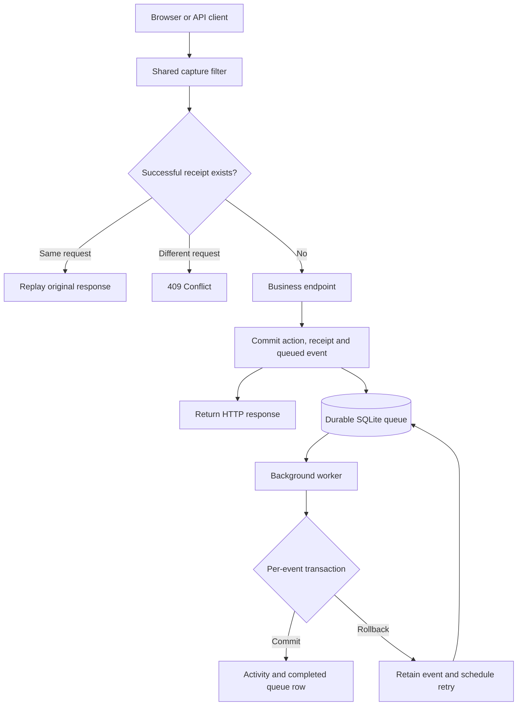

# Automated Activity Tracker

A small ASP.NET Core Web API that captures work on legal cases and turns it into auditable Activity records through a durable background queue. It supports instantaneous actions and server-timed document viewing, with request deduplication, tenant isolation and recovery after processing failures.

The solution includes an interactive browser demo, SQLite persistence and integration tests. It is deliberately scoped to a single API and worker so the behaviour is easy to run, inspect and explain.

**Start here:** [Run locally](#run-locally) · [Use cases](#use-cases-and-expected-results) · [Project structure](#project-structure) · [API](#api-reference) · [Tests](#testing) · [Trade-offs](#assumptions-and-trade-offs)

## Run locally

### Prerequisites

- .NET **9 SDK**, version `9.0.306` or a later `9.0.3xx` patch, selected through `global.json`.
- Optional IDE: Visual Studio 2022 **17.14** with the **ASP.NET and web development** workload, or another .NET-compatible editor.
- Internet access for the first NuGet restore. No database server, cloud account or frontend toolchain is required.

From the folder containing `AutomatedActivityTracker.sln`:

```bash
dotnet --version
dotnet restore AutomatedActivityTracker.sln --locked-mode
dotnet run --project src/ActivityTracker.Api --launch-profile ActivityTracker.Api
```

Open **http://localhost:5080**. The launch profile enables Development mode and the fixed demo identities. The browser calls the real API; the timeline is populated by the actual background worker.

SQLite is created and seeded on first start. Keep the terminal running; stop with Ctrl+C. For Visual Studio, open the solution, set `ActivityTracker.Api` as the startup project and select its launch profile.

Convenience scripts: `./run-demo.ps1` on Windows or `bash run-demo.sh` on Linux/macOS.

### Docker alternative

```bash
docker compose up --build
```

Open the same URL. Compose binds to localhost and persists the database in a named volume. Docker execution has not been verified in the development environment; see [verification](docs/VERIFICATION.md).

### Demo identities

| User | Bearer token | Tenant | Case | Document |
| --- | --- | --- | --- | --- |
| Alice Morgan | `demo-alice` | `north` | 1 — Riverside Estate | 101 — Estate summary |
| Alex Chen | `demo-alex` | `north` | 1 — Riverside Estate | 101 — Estate summary |
| Bob Ahmed | `demo-bob` | `south` | 2 — Cedar Contract | 201 — Contract summary |

These are intentionally public sample tokens, not production credentials. The API derives tenant scope from its server-owned identity mapping. Demo mode is disabled in base configuration and refused outside Development/Testing. All data is fictional.

## Requirement coverage

| Requirement | Implementation | Verification |
| --- | --- | --- |
| Capture without tracking writes inside every endpoint | Shared `CaptureFilter` and opt-in route metadata | HTTP integration tests exercise the real filter |
| Discrete and duration activities | Timestamp-only events; persisted viewing sessions produce start/end events | Null-duration and four-minute duration tests |
| Process asynchronously | SQLite queue polled by `ActivityWorker : BackgroundService` | Notes succeed before the processor runs |
| Prevent duplicates from retries | Tenant/user/key receipt, request fingerprint and unique index | Response replay, conflicting keys and eight concurrent duplicates |
| Survive failures mid-batch | Per-event transactions, retained queue rows, retries and dead letters | Failure after insert, rollback, continuation and host restart |
| Correct case and tenant | Identity-derived tenant, scoped lookups, session ownership and composite foreign keys | Cross-tenant, wrong-document and wrong-user rejection |

## Architecture



The diagram describes actions that produce an event. Starting a viewing session commits the session and receipt; its duration event is queued when the session ends.

### Request boundary: capture reliably

A tracked endpoint declares metadata such as:

```csharp
.WithMetadata(new Capture("NoteAdded"));
```

The filter validates case scope and the idempotency key, checks for a previous receipt, executes the business handler and commits the action, receipt and queue event in one transaction. Endpoint bodies contain business logic; they do not manually write Activity records.

The request waits for **durable acceptance**, not Activity processing. If queue persistence fails, the business write rolls back. If the response is lost after commit, a same-key retry returns the saved response.

### Worker boundary: process safely

The worker polls every 500 ms between batches, selecting up to 20 due Pending events. Each event gets a fresh database context and transaction. It validates the payload, inserts an Activity if its event ID is absent, marks the event Completed and commits.

The Activity ID is the queue event ID. Activity insertion and queue acknowledgement share a transaction: a failure before commit rolls back both. A failure after commit leaves both persisted. Attempts are at least once; database effects are idempotent. No claim of globally exactly-once delivery is made.

Failures back off for 2, 4, 8 and 16 seconds. The fifth failure moves the event to **DeadLetter**. Queue rows remain visible, including completed rows. A failure to poll or record retry metadata is logged; durable pending work remains available for a later poll.

### Why a durable queue?

An in-memory channel would satisfy basic asynchronous processing, but accepted work could disappear on process exit. SQLite lets the business change and event commit together and supports restart recovery without introducing a broker. The trade-off is limited write concurrency and database I/O on the acceptance path.

## Activity model

| Activity type | Trigger | Model | Expected duration |
| --- | --- | --- | --- |
| `NoteAdded` | Successful note creation | Capture timestamp, no end | `null` |
| `DocumentOpened` | Successful document GET | Capture timestamp, no end | `null` |
| `DocumentViewed` | Successful view-session completion | Server-recorded start and end, session ID | `EndedAtMs - StartedAtMs` |

Start/end timestamps are UTC Unix milliseconds. A duration of zero is different from a null duration: zero is a measured interval; null represents a discrete event.

Starting a view persists `ViewSession` immediately. Ending it closes that session and queues one duration Activity. Start retries do not reset its clock; end retries do not create another Activity. Only the owning user can end a session.

An abandoned session remains open and is not converted into a completed duration automatically. Ending it later includes the elapsed time in between. The demo measures elapsed wall-clock time, not focused attention, and does not calculate fees or invoices.

## Use cases and expected results

| Use case | Steps | Expected result |
| --- | --- | --- |
| Add a note | Select Alice, enter text, Save note | HTTP 201; one Note and event; eventual `NoteAdded` Activity |
| Retry a note | Click Retry same request after saving | Original status/JSON replayed with `Idempotency-Replayed: true`; no additional records |
| Create another identical note intentionally | Click Save note again | New key means a new action; another note/event is valid |
| Reuse a key incorrectly | Send different request bytes with an already successful key | HTTP 409; no second business action |
| Open a document | Click Open document | Content returned; eventual discrete `DocumentOpened` Activity |
| Measure viewing | Start viewing, wait, End view | One `DocumentViewed` Activity with server-calculated elapsed duration |
| Leave a view unfinished | Start viewing without ending | Open session remains persisted; no completed duration Activity |
| Repeat session completion | Retry original end request / submit with new key | Original key replays; new key returns 409 for an already closed session |
| Process later | Pause worker, save two notes, Resume | Notes succeed while queued; both Activities appear after processing |
| Recover from one failed event | Pause, add two notes, Fail next item once, Resume | One insert rolls back, other work proceeds; retry completes with no duplicate |
| Recover after restart | Pause, add note, stop and restart using same database | Pending event survives and is processed by the restarted worker |
| Reject another tenant's case | As Alice, request case 2 | HTTP 404; no cross-tenant data returned |
| Reject another user's session closure | Alex attempts to end Alice's session | HTTP 404; Alice's session remains unchanged |
| Reject invalid note | Submit blank text or more than 4,000 characters | HTTP 400; no Note, receipt or event created |
| Reject missing authentication/key | Omit token / omit key on tracked action | HTTP 401 / HTTP 400 respectively |
| Retain permanently failing work | Repeated processing failures | DeadLetter after five failures; visible and eligible for manual requeue after repair |

See [the detailed use-case guide](docs/USE-CASES.md) for repeatable scenarios and expected record counts.

### Five-minute evaluator walkthrough

1. Save a note; wait for one Activity; retry the same request and confirm the count stays unchanged.
2. Start viewing, wait a few seconds, then end it; inspect the measured duration.
3. Pause the worker and save two notes; inspect the Pending rows.
4. Arm one failure and resume; observe rollback, continuation and delayed recovery.
5. Test tenant isolation, then switch to Bob to inspect a separate case and timeline.

The pause applies before a new batch; an already-running batch may finish. Failure/pause controls affect the single worker across both sample tenants.

**Live demo:** available locally at http://localhost:5080 after startup. No public deployment is claimed. [Demo and deployment notes](docs/LIVE-DEMO.md) explain the presentation and hosting requirements.

## Project structure

Paths below are relative to the repository root.

| Path | Responsibility |
| --- | --- |
| `AutomatedActivityTracker.sln` | API and test solution |
| `global.json` | SDK selection compatible with the .NET 9 build |
| `Directory.Build.props` | Generate dependency lock files |
| `src/ActivityTracker.Api/Program.cs` | Dependency registration, middleware and business routes |
| `src/ActivityTracker.Api/Domain/Entities.cs` | Case, User, Document, Note, ViewSession, ActivityEvent, QueueItem, Activity and RequestReceipt |
| `src/ActivityTracker.Api/Data/TrackerDb.cs` | EF Core model, integrity constraints, schema creation and seeding |
| `src/ActivityTracker.Api/Security/DemoIdentity.cs` | Demo authentication and identity helpers |
| `src/ActivityTracker.Api/Tracking/CaptureFilter.cs` | Capture policies, deduplication and transactional acceptance |
| `src/ActivityTracker.Api/Tracking/ActivityWorker.cs` | Polling worker, event processor, retries and demo failure controls |
| `src/ActivityTracker.Api/wwwroot/index.html` | Browser demo using the real API |
| `src/ActivityTracker.Api/Properties/launchSettings.json` | Local Development profile and port |
| `tests/ActivityTracker.Tests/TrackerTests.cs` | Integration scenarios, isolated SQLite databases and controllable clock |
| `ActivityTracker.http` | Ready-to-run HTTP requests |
| `.github/workflows/ci.yml` | Windows/Linux restore, Release build, tests and publish validation |
| `.gitignore`, `.gitattributes`, `.editorconfig` | Repository hygiene and editing conventions |
| `Dockerfile`, `compose.yaml` | Optional container setup with persistent SQLite volume |
| `docs/USE-CASES.md` | Detailed scenarios, outputs and acceptance checks |
| `docs/DEVELOPMENT-GUIDE.md` | Step-by-step explanation of the implementation |
| `docs/LIVE-DEMO.md` | Demonstration and local troubleshooting |
| `docs/VERIFICATION.md` | Actual validation results and untested areas |
| `docs/GIT-PUBLISHING.md` | Initial GitHub publishing and review instructions |

Dependencies are pinned in the project files; committed `packages.lock.json` files support locked restores. There is no separate frontend dependency installation.

## API reference

All `/api` routes require a demo bearer token. Paths below include the `/api` prefix. Tracked actions also require an `Idempotency-Key` of 1–128 characters that is not entirely whitespace.

| Method | Route | Purpose | Key required |
| --- | --- | --- | --- |
| GET | `/health` | Basic process health | No |
| GET | `/api/cases` | List current tenant's cases | No |
| GET | `/api/cases/{caseId}/documents/{documentId}` | Read document and capture opening | Yes |
| POST | `/api/cases/{caseId}/notes` | Create note | Yes |
| GET | `/api/cases/{caseId}/notes/{noteId}` | Read note | No |
| PUT | `/api/cases/{caseId}/documents/{documentId}/views/{sessionId}` | Start session with a fresh GUID | Yes |
| POST | `/api/cases/{caseId}/documents/{documentId}/views/{sessionId}/end` | Complete owned session | Yes |
| GET | `/api/cases/{caseId}/activities` | Latest 100 Activities | No |
| GET | `/api/cases/{caseId}/sessions` | Latest 100 sessions for current user/case | No |
| GET | `/api/demo/queue` | Latest 100 tenant queue items | No |
| POST | `/api/demo/pause` | Pause new worker batches | No |
| POST | `/api/demo/resume` | Resume processing | No |
| POST | `/api/demo/fail-next` | Inject one before-commit failure | No |
| POST | `/api/demo/queue/{id}/retry` | Requeue a tenant-owned DeadLetter item | No |

### Example: create a note

```http
POST /api/cases/1/notes
Authorization: Bearer demo-alice
Idempotency-Key: note-review-001
Content-Type: application/json

{"text":"Reviewed executor instructions."}
```

Illustrative response, with a generated ID:

```json
{
  "id": "5b1b0ce7-a5f0-4c65-9e42-e65e8335b0a1",
  "caseId": 1,
  "tenantId": "north",
  "userId": "alice",
  "text": "Reviewed executor instructions."
}
```

The response is HTTP 201. A same-key retry replays its original status and body. The request receipt is scoped by tenant + user + key. The fingerprint covers method, path, query and exact body bytes; whitespace changes in JSON count as different bytes. New intentional actions require new keys. Validation failures do not reserve keys.

### Error behaviour

| Status | Meaning |
| --- | --- |
| 400 | Invalid note, missing/invalid idempotency key, or malformed request |
| 401 | No valid demo identity |
| 404 | Missing or inaccessible resource; also wrong-user session closure |
| 409 | Conflicting key reuse, reused session ID or already closed session with a new key |
| 503 | SQLite busy/locked error handled by middleware; retry with the same key |

The health endpoint is basic liveness, not a full database/worker readiness check.

## Testing

```bash
dotnet test AutomatedActivityTracker.sln
```

The suite contains 12 integration tests using real SQLite files and ASP.NET Core's in-memory HTTP host. Each test has an isolated database. Tests disable timed background polling and invoke the actual processor explicitly; a controllable server clock makes duration/backoff assertions deterministic.

Coverage includes concurrency, response replay, conflicting keys, invalid input, tenant/user boundaries, duration, abandoned sessions, rollback after projection insertion, dead letters, graceful host restart, atomic acceptance failure and idempotent event reprocessing.

[Verification details](docs/VERIFICATION.md) distinguish locally executed checks from configured CI and untested environments. The GitHub workflow runs on pushes to `main`, pull requests and manual dispatch. A CI status is only established after that workflow runs in the remote repository.

## Extending the solution

To add a discrete action such as `CallLogged`, implement its business route in the protected API group with a `caseId` route value, validate inputs, add any business entity to the shared context, return a JSON result and attach `new Capture("CallLogged")`. Add an integration test for its success and duplicate behaviour.

Tracked handlers participate in the filter's transaction. Keep external side effects and long-running network calls out of that transaction. If a new action needs additional event fields or a different duration policy, evolve the event model and tests explicitly.

## Assumptions and trade-offs

- **Scope:** the separately mentioned starter was not supplied; equivalent Case/User entities and action endpoints are included. Note editing and call logging are extension examples, not implemented features.
- **Deployment:** one API process, one worker and a persistent local SQLite file. Multi-replica operation is not claimed.
- **Authentication:** fixed demo identities, not JWT/OIDC. Tenant members may read their tenant's cases/timeline; session completion additionally requires ownership.
- **Database:** `EnsureCreated` keeps setup small. Schema evolution needs migrations. SQLite's async APIs perform synchronous underlying I/O; this is not a high-throughput queue.
- **Duration:** elapsed time, no idle/heartbeat/overlap/billing policy. Clock reversal is clamped to zero duration. Open sessions remain unbilled until explicitly ended.
- **Deduplication:** successful receipts and completed queue rows are retained indefinitely in this demo. Retention and cleanup need policy decisions.
- **HTTP:** the filter replays JSON/status, not arbitrary response headers, cookies or streams. Document GETs are tracked and uncached; a production viewer should consider explicit interactions to avoid prefetch noise.
- **Consistency:** the timeline is eventually consistent. Pause/failure controls are process-wide demonstration features.
- **Read limits:** latest 100 records, without full pagination.

The implementation avoids a broker, microservices, a generic repository layer and a separate frontend framework to keep the take-home scope understandable. A suggested 4–5 hour allocation is requirements/schema (30 min), capture/idempotency (90 min), worker/duration (60 min), tests (60 min), and documentation/demo (30–60 min). This is a planning estimate, not a measured development-time claim.

## With more time

1. Replace demo identity with validated authentication, tenant membership and role-protected operations.
2. Agree duration and billing rules: heartbeats, idle limits, abandonment and overlapping sessions.
3. Add migrations, pagination, retention and queue-age/failure metrics with alerts.
4. Add browser automation, abrupt process-kill/disk-failure tests and production load testing.
5. For scale, introduce safe claims/leases with suitable storage or an outbox relay and broker; preserve consumer idempotency.
6. For external billing, define a separate idempotency boundary and reconciliation process.

## Troubleshooting

- **SDK not found:** run `dotnet --list-sdks`, then `dotnet --version` from the solution folder. This repository targets .NET 9, not .NET 10.
- **Address already in use:** stop the previous instance, or change the launch profile port and open that port in the browser.
- **401 in the demo:** use the provided Development launch profile.
- **No new Activities:** check whether the worker is paused or events are waiting for retry/in DeadLetter.
- **Reset local data:** stop every app/database-viewer process, then remove `tracker.db` and its `-wal`/`-shm` sidecars from the API working directory. This deletes demo data; startup reseeds users, cases and documents. A relative database path is resolved from the process working directory.

## Documentation and references

- [Detailed use cases](docs/USE-CASES.md)
- [Development guide](docs/DEVELOPMENT-GUIDE.md)
- [Demo walkthrough](docs/LIVE-DEMO.md)
- [Verification record](docs/VERIFICATION.md)
- [Git publishing guide](docs/GIT-PUBLISHING.md)
- [ASP.NET Core endpoint filters](https://learn.microsoft.com/aspnet/core/fundamentals/minimal-apis/min-api-filters)
- [Hosted services](https://learn.microsoft.com/aspnet/core/fundamentals/host/hosted-services)
- [SQLite transactions](https://learn.microsoft.com/dotnet/standard/data/sqlite/transactions)

No open-source license is assigned by this submission; agree licensing and ownership with the recipient before redistribution.
